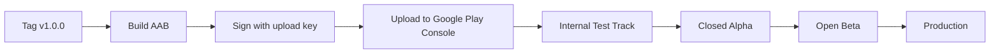
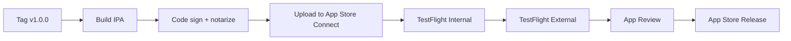

# Kalorientracker Flutter — Architecture

## Directory Structure

```
lib/
├── main.dart                          # Entry point — DI setup, MaterialApp, Provider
├── data/                              # DATA LAYER
│   ├── database/
│   │   ├── app_database.dart          # Singleton SQLite wrapper (3 tables)
│   │   ├── initialize_database.dart   # Conditional export (native vs web)
│   │   ├── initialize_database_native.dart
│   │   ├── initialize_database_web.dart
│   │   └── dao/
│   │       ├── log_dao.dart           # CRUD food_entries + activity_entries
│   │       └── food_item_dao.dart     # CRUD food_items (history)
│   ├── models/
│   │   ├── food_entry.dart            # Logged meal
│   │   ├── activity_entry.dart        # Logged exercise
│   │   ├── food_item.dart             # History entry (per-100g normalized)
│   │   ├── user_profile.dart          # User data + API keys
│   │   ├── calorie_goals.dart         # Daily targets
│   │   ├── enums.dart                 # AiProvider, Gender, ActivityLevel, FitnessGoal
│   │   └── ai_analysis_type.dart      # day/week/month/year/nextMeal
│   ├── repositories/
│   │   ├── log_repository.dart         # Mediates DAOs → Provider
│   │   ├── user_preferences_repository.dart  # SharedPreferences wrapper
│   │   └── api_service_repository.dart       # AI orchestrator + OpenFoodFacts
│   └── services/
│       ├── generative_service.dart          # Abstract interface
│       ├── gemini_api_service.dart          # Gemini 2.5 Flash
│       ├── claude_api_service.dart          # Claude Sonnet 4-5
│       ├── openai_api_service.dart          # GPT-4o
│       ├── grok_api_service.dart            # Grok-4 (xAI)
│       └── food_api_service.dart            # OpenFoodFacts barcode lookup
├── logic/                              # BUSINESS LOGIC LAYER
│   ├── goals_calculator.dart           # BMR (Mifflin-St Jeor) → TDEE → macros
│   └── providers/
│       └── main_provider.dart          # Central ChangeNotifier (single state atom)
└── ui/                                # PRESENTATION LAYER
    ├── theme/
    │   └── app_theme.dart              # 4 Material 3 themes
    ├── screens/
    │   ├── home_screen.dart            # Daily log (main screen)
    │   ├── profile_screen.dart         # Profile + API keys
    │   ├── photo_input_screen.dart     # Camera/gallery picker
    │   └── barcode_scanner_screen.dart # Live barcode scanner
    └── widgets/
        ├── goals_summary_card.dart     # Calorie/macro progress
        ├── food_item_row.dart          # Food list item
        ├── activity_item_row.dart      # Activity list item
        └── dialogs/
            ├── add_entry_dialog.dart             # Input method chooser
            ├── unified_input_dialog.dart         # Smart text (AI classifies)
            ├── edit_food_dialog.dart             # Manual food edit
            ├── edit_activity_dialog.dart         # Manual activity edit
            ├── delete_confirmation_dialog.dart
            ├── barcode_scanner_dialog.dart       # Scan result + gram picker
            ├── ai_assistant_dialog.dart          # AI review launcher
            └── food_recall_dialog.dart           # History browser
```

## Architecture Style: Clean Architecture Lite (Layer-based)

```
┌─────────────────────────────────────────────────────────────┐
│                   PRESENTATION LAYER (ui/)                  │
│                                                             │
│  Screens ─── Widgets ─── Dialogs                            │
│       │                        │                            │
│       └─────── Consumer<MainProvider> ──────┘               │
│                        │                                    │
│                  context.read/write                         │
└────────────────────────┼────────────────────────────────────┘
                         │
┌────────────────────────┼────────────────────────────────────┐
│             BUSINESS LOGIC LAYER (logic/)                   │
│                                                             │
│  ┌──────────────────┐    ┌──────────────────────────────┐  │
│  │  GoalsCalculator  │    │       MainProvider           │  │
│  │  (pure functions) │    │  (ChangeNotifier — state)    │  │
│  └──────────────────┘    │  - selectedDate               │  │
│                          │  - foodEntries                │  │
│                          │  - activityEntries            │  │
│                          │  - userProfile                │  │
│                          │  - goals                      │  │
│                          │  - currentTheme               │  │
│                          │  - errorMessage               │  │
│                          │  - isLoading                  │  │
│                          └──────┬───────────────────────┘  │
└─────────────────────────────────┼──────────────────────────┘
                                  │
┌─────────────────────────────────┼──────────────────────────┐
│                    DATA LAYER (data/)                      │
│                                                             │
│  ┌──────────────────┐  ┌──────────────────────────┐        │
│  │  LogRepository    │  │  UserPreferencesRepo    │        │
│  │  ┌──────────────┐│  │  (SharedPreferences)     │        │
│  │  │ LogDao       ││  └──────────────────────────┘        │
│  │  │ FoodItemDao  ││                                      │
│  │  └──┬───────────┘│  ┌──────────────────────────┐        │
│  └─────┼────────────┘  │  ApiServiceRepository     │        │
│        │               │  ┌──────────────────────┐│        │
│  ┌─────┴──────────┐    │  │ GenerativeService    ││        │
│  │    SQLite       │    │  │ (Strategy pattern)  ││        │
│  │  (sqflite)      │    │  │  ├─ GeminiApiService││        │
│  └────────────────┘    │  │  ├─ ClaudeApiService ││        │
│                        │  │  ├─ OpenAiApiService ││        │
│                        │  │  └─ GrokApiService   ││        │
│                        │  └──────────────────────┘│        │
│                        │  ┌──────────────────────┐│        │
│                        │  │  FoodApiService       ││        │
│                        │  │  (OpenFoodFacts)      ││        │
│                        │  └──────────────────────┘│        │
│                        └──────────────────────────┘        │
└─────────────────────────────────────────────────────────────┘
```

## Data Flow

```
User Action (tap, text input, barcode scan, photo, history select)
        │
        ▼
Widget callback ──► MainProvider.method()
        │
        ├──► saveUserProfileAndRecalculateGoals() ──► GoalsCalculator
        │       ▼                                        ▼
        │   UserPreferencesRepo                    CalorieGoals
        │
        ├──► addFoodItem / addActivityItem / addUnifiedEntry / addFoodFromImage
        │       ▼
        │   ApiServiceRepository
        │       ├──► GenerativeService.getApiResponse()  ──► AI API (Gemini/Claude/OpenAI/Grok)
        │       └──► parse JSON response into FoodNutritionInfo / ActivityInfo
        │       ▼
        │   LogRepository
        │       ├──► LogDao.insertFoodEntry() / insertActivityEntry()
        │       └──► FoodItemDao.insert() (if food)
        │
        ├──► addScannedFoodItem()
        │       ▼
        │   ApiServiceRepository.fetchBarCodeNutrition() ──► FoodApiService (OpenFoodFacts)
        │       ▼
        │   LogRepository ──► LogDao.insertFoodEntry()
        │
        ├──► addFoodItemFromHistory()
        │       ▼
        │   LogRepository ──► LogDao.insertFoodEntry() (scaled by amount)
        │
        ├──► changeDate() ──► LogRepository ──► LogDao (query by date)
        ├──► changeTheme() ──► UserPreferencesRepo.saveTheme()
        ├──► deleteFoodItem/deleteActivityItem() ──► LogRepository ──► LogDao.delete()
        ├──► reFetchFoodItem/reFetchActivityItem() ──► ApiServiceRepository (re-AI)
        └──► performAiAnalysis() ──► ApiServiceRepository (AI review) ──► MainProvider (analysis result)
        │
        ▼
   MainProvider.updateState() + notifyListeners()
        │
        ▼
   Consumer<MainProvider> rebuilds UI
```

## Key Design Decisions

### State Management
- **Provider** (single `ChangeNotifier`: `MainProvider`)
- All application state lives in one class: selectedDate, entries, profile, goals, theme, UI state
- Widgets rebuild via `Consumer<MainProvider>` or `context.watch<MainProvider>()`

### Database (SQLite)
- **sqflite** for Android/iOS, **sqflite_common_ffi** for desktop, **sqflite_common_ffi_web** for web
- Conditional exports via Dart's `export if (dart.library.html)` pattern
- 3 tables: `food_entries`, `activity_entries`, `food_items`
- DAO pattern: `LogDao` + `FoodItemDao` mediate all SQL
- Versioned schema with migration (v1 → v2 added amount/unit/food_item_id + food_items table)

### AI Integration (Strategy Pattern)
- Abstract `GenerativeService` interface with 4 implementations
- User selects provider at runtime; `MainProvider` calls `ApiServiceRepository.setProvider()`
- All prompts in German, instructing strict JSON output
- Response cleaning: strips markdown code fences before JSON parsing

### Goals Calculation
- Mifflin-St Jeor BMR: `10w + 6.25h - 5a + {5 | -161}`
- TDEE = BMR × activity multiplier
- Target = TDEE + goal modifier (clamped to safety floor)
- Macro split varies by goal (protein: 1.5–2.0g/kg, fat: 25–30%, carbs fill remainder)

### Navigation
- **Navigator 1.0** (push/pop), no routing package
- Full-screen routes: HomeScreen, ProfileScreen, PhotoInputScreen, BarcodeScannerScreen
- All other flows are `showDialog()` (EditFood, EditActivity, AddEntry, AIAnalysis, FoodRecall, etc.)

### Theming
- 4 Material 3 themes (Default/Ocean — light; Dark Forest/Dark Purple — dark)
- Selected via `main_provider.currentTheme`, stored in SharedPreferences
- All use `useMaterial3: true`

## Conventions

### Immutability
- All models use `final` fields + `copyWith` methods
- `FoodEntry`, `ActivityEntry`, `UserProfile`, `CalorieGoals` are immutable

### IDs
- Entities use `uuid` v4 (package: `uuid`)
- `FoodItem.id` derived from name: `name.toLowerCase().replaceAll(' ', '_')`

### Error Handling
- AI services prefix exceptions: `GeminiError: ...`, `ClaudeError: ...`
- `MainProvider` catches → sets `_errorMessage` → UI shows `errorContainer`

### Testing
- **Currently no active tests** — 1 skeleton test file (commented out)
- Needs mock repositories for testing with DI

---

## DevOps & Deployment Strategy

### CI/CD Pipeline (Recommended: GitHub Actions)

```
.github/workflows/
├── ci.yml                  # PR checks: analyze, test, build
├── release.yml             # Tagged releases
├── deploy-web.yml          # Web → Firebase Hosting
└── deploy-mobile.yml       # Mobile → stores
```

#### Pipeline Stages

```
┌──────────┐   ┌──────────┐   ┌───────────┐   ┌──────────┐
│  Analyze  │   │   Test   │   │   Build   │   │  Deploy   │
│  flutter  │──▶│  flutter │──▶│  flutter  │──▶│ (per     │
│  analyze  │   │  test    │   │  build    │   │ platform)│
└──────────┘   └──────────┘   └───────────┘   └──────────┘
```

| Stage | Command | Artifact |
|-------|---------|----------|
| Lint | `flutter analyze` | — |
| Test | `flutter test` | coverage report |
| Build APK | `flutter build apk --release` | `build/app/outputs/flutter-apk/` |
| Build AAB | `flutter build appbundle --release` | `build/app/outputs/bundle/` |
| Build IPA | `flutter build ios --release --no-codesign` | `build/ios/ipa/` |
| Build Web | `flutter build web --release` | `build/web/` |
| Build Windows | `flutter build windows --release` | `build/windows/runner/Release/` |
| Build macOS | `flutter build macos --release` | `build/macos/Build/Products/Release/` |
| Build Linux | `flutter build linux --release` | `build/linux/x64/release/bundle/` |

### Platform-Specific Deployment

#### Android — Google Play Store



- **Signing**: Store upload keystore in repo secrets (not in repo)
- **Versioning**: `version: 1.0.0+1` in `pubspec.yaml`; CI bumps build number via `--build-number=${{ github.run_number }}`
- **Fastlane** (optional): automate Play Store upload via `fastlane supply`

#### iOS — App Store



- **Certificate management**: GitHub Actions match/certificates via `apple-actions/import-codesign-certs`
- **Required secrets**: `APP_STORE_CONNECT_API_KEY`, `BUILD_CERTIFICATE_BASE64`, `BUILD_PROVISION_PROFILE_BASE64`

#### Web — Firebase Hosting

```
# firebase.json (recommended)
{
  "hosting": {
    "public": "build/web",
    "ignore": ["firebase.json", "**/.*"],
    "rewrites": [{ "source": "**", "destination": "/index.html" }],
    "headers": [
      { "source": "**/*.@(wasm|js|css)", "headers": [
        { "key": "Cache-Control", "value": "public, max-age=31536000, immutable" }
      ]}
    ]
  }
}
```

- Deploy via `firebase deploy --only hosting` (requires Firebase project)
- PWA support via `web/manifest.json` already configured

#### Windows — MSIX / Installer

- **Option A**: `flutter build windows --release` → distribute as portable ZIP
- **Option B**: Create MSIX package via `msix` pub package
- **Option C**: Use Inno Setup or WiX Toolset for `.exe` installer
- **Signing**: Authenticode certificate for Windows SmartScreen

#### macOS — DMG

- `flutter build macos --release` → code sign + notarize
- Package as `.dmg` via `create-dmg` or `appdmg` (Node.js)
- Distribute via website or Mac App Store

#### Linux — AppImage / Flatpak / Snap

- `flutter build linux --release`
- Package as AppImage via `linuxdeploy`
- Or Snapcraft: `snapcraft` (works with Flutter's Linux build output)

### Version Management

```
pubspec.yaml:
  version: MAJOR.MINOR.PATCH+BUILD

CI sets BUILD = github.run_number for each platform build.
Semantic release: git tag trigger bumps version automatically.
```

### Environment Configuration

| Environment | Purpose | API Keys | Database |
|-------------|---------|----------|----------|
| Development | Local coding | User's own keys | Local SQLite |
| Staging | Pre-release testing | Test API keys | Local SQLite |
| Production | App store release | User's own keys | Local SQLite |

Since the app is **fully local-first** (no backend), there is no separate backend environment. API keys are entered by the user in-app and stored in SharedPreferences.

### Git Workflow


| Branch | Purpose | CI triggers |
|--------|---------|-------------|
| `main` | Stable, production-ready | Full analyze + test + build all platforms |
| `develop` | Integration branch | Analyze + test |
| `feat/*` | Feature branches | Analyze + test |
| `release/v*` | Release candidates | Full build + deploy to test tracks |
| `hotfix/*` | Urgent production fixes | Same as release |

### Required Secrets (GitHub Actions)

| Secret | Purpose |
|--------|---------|
| `PLAY_STORE_SERVICE_ACCOUNT_JSON` | Google Play API access |
| `ANDROID_SIGNING_KEY_BASE64` | App signing keystore |
| `ANDROID_KEY_ALIAS` | Keystore alias |
| `ANDROID_KEY_PASSWORD` | Keystore password |
| `ANDROID_STORE_PASSWORD` | Store password |
| `APP_STORE_CONNECT_API_KEY` | App Store Connect API auth |
| `BUILD_CERTIFICATE_BASE64` | iOS distribution certificate |
| `BUILD_PROVISION_PROFILE_BASE64` | iOS provisioning profile |
| `CERTIFICATES_P12_PASSWORD` | P12 password |
| `FIREBASE_TOKEN` | Firebase deployment |
| `PAT_TOKEN` | Personal access token for git ops |

### Suggested Tooling

| Tool | Purpose |
|------|---------|
| GitHub Actions | CI/CD orchestration |
| Fastlane (optional) | Mobile deployment automation |
| Firebase Hosting | Web deployment |
| Sentry / Crashlytics | Error tracking (future) |
| CodeMagic (alternative) | All-in-one Flutter CI/CD |

### Current Status
- **No CI/CD configured** — all builds are manual via `flutter build`
- **No automated testing** — skeleton test only
- **No deployment pipeline** — APK/IPA/web builds generated locally
- **No code signing setup** — signing handled manually in local IDE
